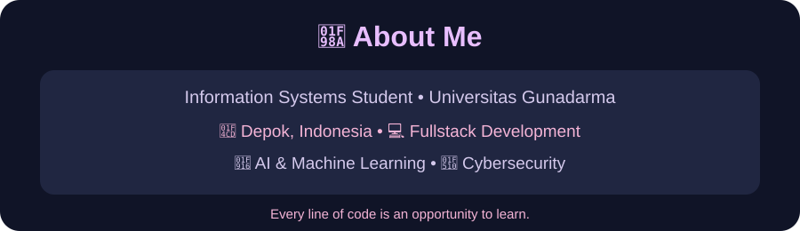
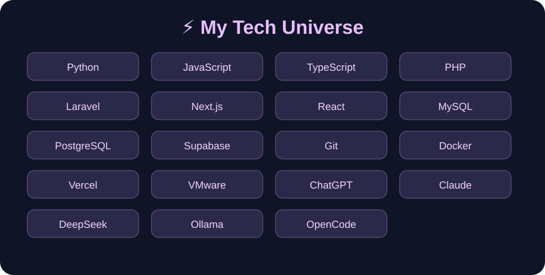

<!-- Animated decoration from the original profile -->

 

*“No one is coming to fight your battles. So rise, and fight for yourself.”*

**— Hafourenai 🌸**

<!-- Replace Hafourenai with your exact GitHub username in the URLs below. -->

 

 

